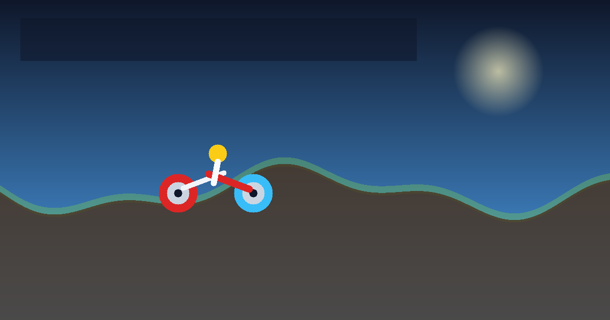

# TORQUE OVERDRIVE

Endless, procedurally generated, Hill-Climb-Racing-style arcade physics game. Pure HTML5 Canvas, no runtime dependencies, no build step. Runs in any modern browser and installs as a PWA.




Canonical / Open Graph URLs in `index.html` use a Pages placeholder that CI rewrites to the real owner/repo URL. For a manual deploy, replace that placeholder in `index.html` (canonical, `og:url`, `og:image`, `twitter:image`) by hand.

## Features

- **Procedural tracks** (seeded Perlin, 3 stacked octaves, new seed every run) in 5 biomes: Countryside, Desert, Arctic Ice (low friction), Moon (0.38 g, craters), Swamp Mud (high drag). Day/night/weather vary per seed. Visual surface is Catmull-Rom interpolated; physics stays on the linear polyline for determinism.
- **Solvability guarantee:** `max_slope = atan(min(0.5*mu, T/(m g r)))` so every hill is climbable by the stock bike; slope change per sample is rate-limited (min curvature radius ~500 px, no wedging valleys), and `TOSim.validate()` checks it. Fuel cans are placed every 1500-2100 px on the road.
- **Fuel** (drains faster on throttle/nitro), **coins** on crest arcs and climbs, flip / 500 m bonuses.
- **Nitro (Shift / NITRO only):** 2.0x rear-wheel torque, raised RPM ceiling, fire particles, wider camera FOV, screen shake. Meter charges with a smooth catch-up curve.
- **Preload / bunny hop (Space / HOP only):** hold compresses both springs; release fires an upward impulse. Shift and Space are never shared.
- **Garage** (menu / pause / game over): 4 upgrades x 8 levels (Engine, Suspension, Tyre Grip, Fuel Tank). Selecting Classic Stunt Bike, 4x4 Hill Climber, or High-Speed Quad re-instantiates the rigid body from that profile on the next run. Progress saved in `localStorage` (`tod2`).
- **Physics:** 240 Hz fixed step, spring-damper suspension, impulse tyre contact. Tangential gravity beats static friction so the bike rolls back down hills when throttle is released.
- **Rider:** IK-articulated limbs. Head or inverted-roof impact severs the rider into a 6-node verlet ragdoll.
- **Juice:** layered parallax biomes, bike shadows, speed lines, pooled particles, landing / nitro screen shake (honours reduced motion).
- **PWA / offline:** `manifest.webmanifest` + service worker. Navigations are network-first; static assets are stale-while-revalidate. Works under a GitHub Pages subpath.
- **Audio:** procedural Web Audio engine (RPM-pitched), nitro, landing, coin, fuel, crash; master / music / SFX volumes + mute persisted. Unlocks on first gesture; pauses when the tab blurs.
- **Input:** keyboard (rebindable), touch overlay, Gamepad API (sticks / triggers / buttons). Optional haptics via `navigator.vibrate`.
- **UX:** settings (quality Low/Med/High, reduced motion, haptics, FPS, control layout/size), fullscreen, orientation hint, first-run tutorial, per-biome best distance/coins, local stats/achievements, share score (`navigator.share` / clipboard). `?seed=123` replays a track.

## Controls

| Action | Desktop | Touch | Gamepad |
| --- | --- | --- | --- |
| Gas | W / Up | GAS | RT / A |
| Brake / reverse | S / Down | BRAKE | LT / B |
| Tilt | A/D or arrows | TILT | D-pad / left stick |
| Nitro | Shift | NITRO | RB / X |
| Hop | Space | HOP | LB / Y |
| Pause | Esc / P | pause button | Start |
| Restart | R | RETRY | — |

Keyboard still works on hybrid devices. Rebind keys in Settings.

## Local run

No build. From the project root:

```bash
python3 -m http.server 8080
```

Open `http://localhost:8080/`. To mimic GitHub Pages under a subpath, serve the parent folder and open `http://localhost:8080/<folder>/`.

## Testing

```bash
node --check sim.js
node --check game.js
node --check sw.js
node --check verify.js
node --check e2e.mjs
node verify.js
npm test
```

`verify.js` covers terrain validity, wheel omega, hill roll-back, nitro, fuel, ragdoll, and same-seed determinism. `e2e.mjs` drives Playwright against a `/sub/` static server (installs Chromium via `npx playwright install chromium`). Playwright is a devDependency only.

## GitHub Pages

Set Pages source to **GitHub Actions** (Settings → Pages → Source). Push to `main`; `.github/workflows/pages.yml` runs checks, rewrites the Pages placeholder URL to `https://<owner>.github.io/<repo>/` (owner lowercased), and deploys. That substitution is automatic in CI. A manual deploy still requires editing the placeholder in `index.html` by hand. The service-worker cache version is auto-stamped per deploy (`tod-<sha>`).

Paths are relative except the documented canonical / OG placeholders. Optional `?seed=123` replays a specific track. Keep `.nojekyll` so Pages does not treat the site as Jekyll.

## PWA install

- Chrome / Edge / Android: install prompt or browser menu → Install app.
- iOS Safari: Share → Add to Home Screen.
- Offline: first visit must be online so the service worker can precache.

## Files

```
index.html              game shell
sim.js                  240 Hz physics
game.js                 renderer, audio, UI, input
sw.js                   service worker
manifest.webmanifest    PWA manifest
icon.svg icon-192.png icon-512.png icon-maskable.png apple-touch-icon.png
social.png              1200x630 Open Graph image
404.html                relative link home
robots.txt
verify.js e2e.mjs package.json package-lock.json
.github/workflows/pages.yml
LICENSE README.md .nojekyll .gitignore
```

## License

MIT. See `LICENSE`.
